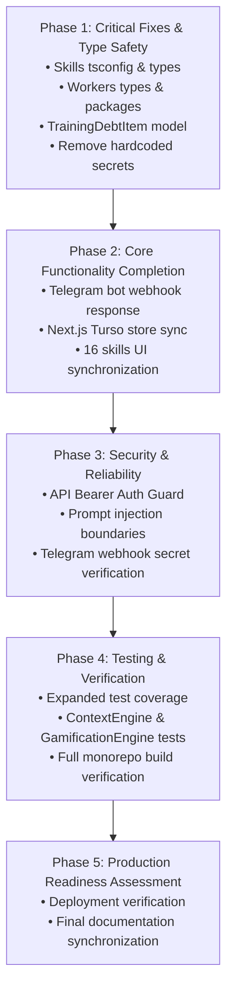

# 8. Implementation Roadmap & Execution Strategy

This document outlines the phased roadmap to remediate all identified vulnerabilities, fix broken functionality, complete partially implemented features, and verify production readiness for the **Private AI Mentor OS**.

---

## Phased Implementation Overview

---

## Phase Details

### Phase 1: Critical Fixes & Type Safety (P0)
- **Objective**: Fix all compilation failures, type mismatches, and exposed secret strings.
- **Tasks**:
  1. Add `skills/tsconfig.json` and `"build": "tsc --noEmit"` to `skills/package.json`.
  2. Add `@cloudflare/workers-types` devDependency to `workers/mentor-api/package.json`.
  3. Update `TrainingDebtItem` in `@personal-mentor/shared` to include `targetWeaknessId?: string;`.
  4. Fix literal type inference in `workers/mentor-api/src/store.ts`.
  5. Purge hardcoded API tokens from `wrangler.toml`, `migrate-turso.ts`, and test files.

### Phase 2: Core Functionality Completion (P1)
- **Objective**: Restore broken Telegram webhook integration, synchronize UI skill taxonomy, and prevent database desynchronization.
- **Tasks**:
  1. Update `/api/telegram/webhook` to return the standard Telegram method response:
     `{ "method": "sendMessage", "chat_id": chatId, "text": replyText, "parse_mode": "Markdown" }`.
  2. Add outbound `fetch` to `https://api.telegram.org/bot<TOKEN>/sendMessage` if `TELEGRAM_BOT_TOKEN` is configured.
  3. Update `apps/web/src/components/SkillsView.tsx` and `DesktopSidebar.tsx` to display all 16 skills.
  4. Connect `apps/web/src/lib/server-state.ts` to Turso database when `TURSO_DATABASE_URL` is set in environment.

### Phase 3: Security & Reliability (P1)
- **Objective**: Protect user privacy and API endpoints.
- **Tasks**:
  1. Implement `AUTH_SECRET` bearer token validation on `workers/mentor-api/src/index.ts`.
  2. Implement prompt boundary delimiters (`<user_defense>...</user_defense>`) to prevent prompt injection attacks in assessment evaluation.

### Phase 4: Testing & Verification (P2)
- **Objective**: Expand test coverage and ensure green builds across the entire workspace.
- **Tasks**:
  1. Add unit tests for `ContextEngine`, `GamificationEngine`, and `RealityModeEngine`.
  2. Add unit tests for Telegram webhook response formatting.
  3. Run `pnpm build` across all workspace projects and `bun test` across all packages.

### Phase 5: Production Deployment Readiness (P3)
- **Objective**: Verify readiness for Cloudflare Workers and Next.js production deployment.
- **Tasks**:
  1. Update `README.md` and `.env.example` to accurately document Turso libSQL, 16 skills, and setup commands.
  2. Verify all audit documentation in `/docs/audit/`.
