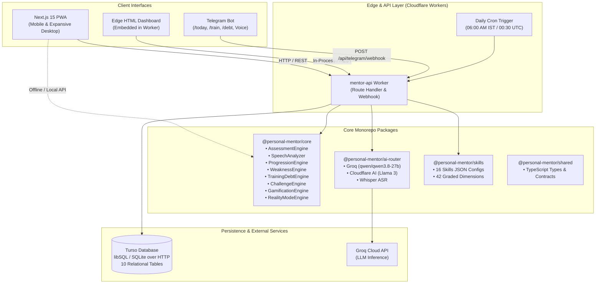

# 1. Project Overview & Architecture: Private AI Mentor OS

## Executive Description
**Private AI Mentor OS** is an adversarial, action-oriented personal skill development engine. Unlike generic chat-based AI assistants that provide pleasantries and unstructured conversational advice, this system is explicitly engineered to:
1. Continuously measure real-world user performance through timed drills and speech submissions.
2. Deliberately induce failure at the boundary of competence.
3. Diagnose micro-weaknesses objectively through a 16-skill, 42-dimension rubric.
4. Enforce extreme accountability via deterministic **Training Debt** and an "Anti-Luck" progression ladder.

---

## Architecture Diagram

---

## Monorepo Layout & Workspaces

The codebase is structured as a `pnpm` workspace monorepo:

| Directory | Package Name | Role & Technology |
| :--- | :--- | :--- |
| `apps/web` | `mentor-web` | Next.js 15.1.7 (App Router), React 19, Tailwind CSS 3.4.17, Lucide React, Web Speech API |
| `workers/mentor-api` | `mentor-api` | Cloudflare Worker edge service, Wrangler 3.109.2, `@libsql/client/web` |
| `packages/mentor-core` | `@personal-mentor/core` | 8 deterministic calculation engines, zero runtime external dependencies |
| `packages/ai-router` | `@personal-mentor/ai-router` | Multi-provider LLM router (Groq, Cloudflare AI, mock fallback) |
| `packages/skills` | `@personal-mentor/skills` | 16 skill definitions in JSON, 42 dimensions, scoring criteria |
| `packages/shared` | `@personal-mentor/shared` | Core TypeScript interfaces, API payloads, database models |
| `database` | N/A | Turso migration script (`migrate-turso.ts`), PostgreSQL schema/seed |
| `prompts` | N/A | Raw markdown prompts for mentor, evaluator, challenge generation |

---

## Technology Stack

- **Runtime Environments**: Node.js v22.23.2, Bun v1.4.2 (used for testing), Cloudflare Workers (Workerd V8 edge runtime).
- **Package Manager**: pnpm 12.4.2.
- **Frontend**: Next.js 15.1.7 (Turbopack/Webpack), React 19.0.0, Tailwind CSS 3.4.17.
- **Backend / Edge**: Cloudflare Workers API.
- **Database**: Turso Database (`libsql://learning-sh15aa.aws-ap-south-1.turso.io`) using `@libsql/client`.
- **AI Models**: Groq Cloud API (`qwen/qwen3.8-27b`), Cloudflare Workers AI (`@cf/meta/llama-3-8b-instruct`, `@cf/openai/whisper`).
- **Acoustic & Speech Analysis**: Deterministic in-browser and server-side `SpeechAnalyzer` (cadence WPM, filler word density, pause estimation).
- **Communication Integrations**: Telegram Bot Webhook.
